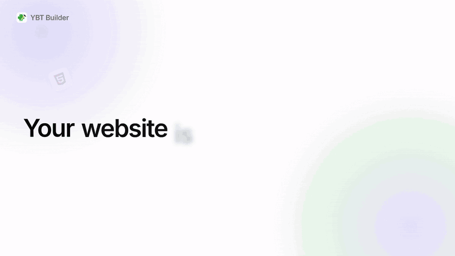
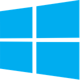
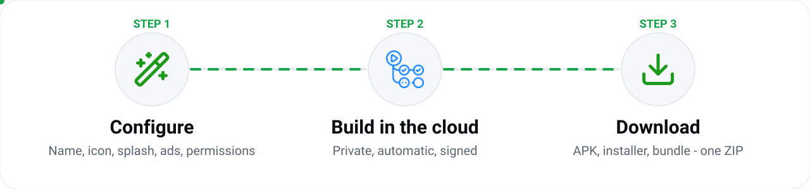

<div align="center">



<br>

**A guided builder that turns a website or an offline HTML project into signed Android apps —<br>configured in minutes, built in the cloud, delivered as one ZIP.**

<br>

[](../../releases/latest)
[](../../releases)


[**Website**](https://youbtech01.github.io/ybt-builder-releases/) &nbsp;·&nbsp; [**Download**](../../releases/latest) &nbsp;·&nbsp; [**Watch the video**](assets/media/ybt-builder-launch-video.mp4)

</div>

<br>

## See it in action

<div align="center">

[](assets/media/ybt-builder-launch-video.mp4)

<sub>Click the preview to watch the full 40-second launch video.</sub>

</div>

<br>

## Download

Pick your system. Every button opens the release page with the matching files and a `SHA256SUMS.txt` to verify them.

<table>
  <tr>
    <td align="center" width="25%"><a href="../../releases/latest"></a><br><b>Android</b><br><sub>7.0+ · Universal, ARM64, ARM32, x86_64 APKs</sub><br><br><a href="../../releases/latest"><b>Download ›</b></a></td>
    <td align="center" width="25%"><a href="../../releases/latest"></a><br><b>Windows</b><br><sub>10 / 11 · 64-bit · <code>setup.exe</code> installer</sub><br><br><a href="../../releases/latest"><b>Download ›</b></a></td>
    <td align="center" width="25%"><a href="../../releases/latest"></a><br><b>Linux</b><br><sub>x64 · portable <code>.tar.gz</code> bundle</sub><br><br><a href="../../releases/latest"><b>Download ›</b></a></td>
    <td align="center" width="25%"><a href="../../releases/latest"></a><br><b>Web</b><br><sub>Production build · host anywhere</sub><br><br><a href="../../releases/latest"><b>Download ›</b></a></td>
  </tr>
</table>

> **Which Android file?** If you are unsure, take the *universal* APK. Newer phones usually run **ARM64**, older phones **ARM32**, and emulators **x86_64**.

<br>

## How it works

<div align="center">

</div>

<br>

## Features

<table>
  <tr>
    <td width="50%" valign="top">
      <b>Website or offline ZIP</b><br>
      Wrap a live site, or bundle an offline HTML project that runs fully inside the app.
    </td>
    <td width="50%" valign="top">
      <b>Splash &amp; branding</b><br>
      Icon, colors, splash screen, timing and exit animation — with a live phone preview.
    </td>
  </tr>
  <tr>
    <td valign="top">
      <b>AdMob monetization</b><br>
      Optional banner and interstitial ads with policy-friendly intervals.
    </td>
    <td valign="top">
      <b>Permissions on demand</b><br>
      Camera, microphone, location, files and notifications — only what your site needs.
    </td>
  </tr>
  <tr>
    <td valign="top">
      <b>Private cloud builds</b><br>
      Builds run on GitHub Actions in your own private repository. No build server to manage.
    </td>
    <td valign="top">
      <b>Signed APK + AAB</b><br>
      Release-ready packages with your own signing key, plus the Android project and a build report.
    </td>
  </tr>
  <tr>
    <td valign="top">
      <b>AI agent</b> <sub>(coming soon)</sub><br>
      Describe a site and let the agent create and edit its files with an instant preview.
    </td>
    <td valign="top">
      <b>Always up to date</b><br>
      Built-in update notices make sure everyone runs the latest version.
    </td>
  </tr>
</table>

<br>

## The wizard

| # | Step | You choose |
| :-: | --- | --- |
| 1 | **Details** | App name, package ID, version, icon, brand colors |
| 2 | **Content** | Live website or offline bundle, loading indicator, pull-to-refresh, pinch-to-zoom, external links |
| 3 | **Appearance** | Splash background and logo, display time, exit animation |
| 4 | **Monetize** | Optional AdMob banner and interstitial ads |
| 5 | **Permissions** | Device access and manifest options |
| 6 | **Review** | Signing key and one-tap build |

<br>

## Supported platforms

<div align="center">

| <br>Android | <br>Windows | <br>Linux | <br>Web |
| :-: | :-: | :-: | :-: |
| APK ×4 · AAB | `setup.exe` | `.tar.gz` | `.zip` |

</div>

<br>

## Built with

<div align="center">

&nbsp;&nbsp;
&nbsp;&nbsp;
&nbsp;&nbsp;
&nbsp;&nbsp;
&nbsp;&nbsp;
&nbsp;&nbsp;
&nbsp;&nbsp;
&nbsp;&nbsp;
&nbsp;&nbsp;


</div>

<br>

## What is in this repository

This is the **public distribution repository**. It contains only finished downloads and presentation material — the source code is private.

```
.
├── index.html              Download website (served with GitHub Pages)
├── README.md               This page
└── assets/
    ├── banner.svg          Animated README banner
    ├── flow.svg            Animated "how it works" graphic
    ├── logos/              Technology and platform logos
    ├── icons/              Interface icons
    └── media/
        ├── ybt-builder-launch-video.mp4   Product launch video
        ├── preview.gif                    Looping preview
        └── poster.jpg                     Video poster
```

Release files (APK, installer, Linux bundle, web bundle and checksums) are attached to each [release](../../releases).

<br>

## FAQ

<details>
<summary><b>Do I need a product key?</b></summary>
<br>
Yes. Access to the builder is protected by a product key from You B Tech. Each key has a limit on how many apps it can build, and the remaining quota is shown inside the app.
</details>

<details>
<summary><b>Where are my apps built?</b></summary>
<br>
On GitHub Actions, in a private repository in your own GitHub account.
</details>

<details>
<summary><b>Windows shows an "unknown publisher" warning.</b></summary>
<br>
The installer is not signed with a paid code-signing certificate yet, so Windows SmartScreen may ask for confirmation. Choose <i>More info</i> → <i>Run anyway</i>, and compare the file with the published <code>SHA256SUMS.txt</code>.
</details>

<br>

<div align="center">

**You B Tech** &nbsp;·&nbsp;
[](https://youtube.com/@You_B_Tech) &nbsp;
[](https://www.instagram.com/youbtech_code) &nbsp;
[](https://t.me/You_B_Tech) &nbsp;
[](https://x.com/You_B_Tech) &nbsp;·&nbsp;
[ybtshop.com](https://ybtshop.com)

<sub>© You B Tech. All rights reserved.</sub>

</div>
